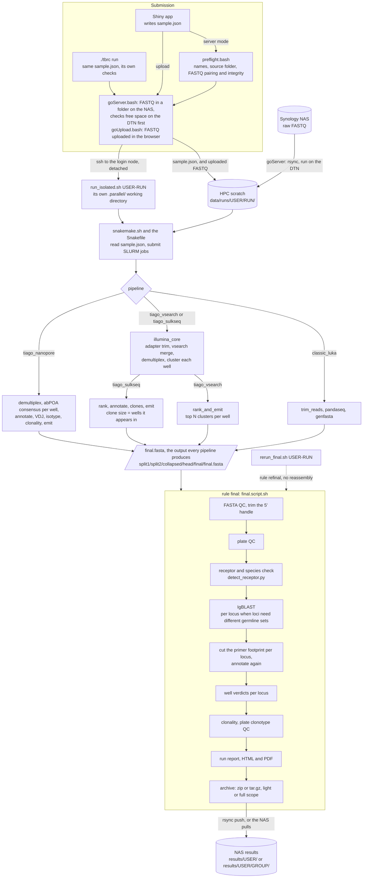

# TBRC Pipeline

TBRC turns sequencing reads from plate-based antibody and T-cell receptor cloning into annotated
sequences for every well. You give it the FASTQ files of a library and the barcode set its plates
used. It trims and assembles the reads, sorts them into plates and wells, annotates the sequences with
IgBLAST, can call clones, and delivers a report and an archive of the results.

It is a Snakemake workflow ([`backend/`](backend)) with a Shiny submission form
([`frontend/`](frontend)) and a terminal tool (`./tbrc`). Runs can happen on your own computer or on a
SLURM cluster.

> **New here?** Follow the [step-by-step tutorial](docs/tutorial.html), from a fresh download to your
> first finished run. GitHub shows that file as source code, so clone the repository and open
> `docs/tutorial.html` in your browser.

## Contents

**Start here:**
[Quick start](#quick-start-for-new-users) ·
[Which setup do I want?](#which-setup-do-i-want) ·
[Your first run](#your-first-run)

**Using TBRC:**
[Guided setup](#guided-setup-tbrc-setup) ·
[Security](#security-the-app-has-no-login-of-its-own) ·
[Running from the terminal](#running-from-the-terminal-no-browser) ·
[What is accepted](#what-is-accepted-and-what-a-refusal-looks-like) ·
[The results archive](#what-ends-up-in-the-results-archive) ·
[Troubleshooting](#troubleshooting)

**How it works:**
[What TBRC does](#what-tbrc-does) ·
[How a run flows](#how-a-run-flows) ·
[Repository layout](#repository-layout)

**Installing by hand, and reference:**
[Installing by hand](#installing-by-hand) ·
[Required configuration](#required-configuration) ·
[Local development](#local-development-setup) ·
[Cluster installation](#hpc--backend-installation) ·
[Shiny Server installation](#shiny-server-installation) ·
[Runtime variables](#runtime-variables-used-by-the-backend) ·
[Bring-up checklist](#minimal-bring-up-checklist) ·
[First validation run](#first-validation-run) ·
[License](#license)

## Quick start for new users

You need `git`, Python 3.9 or newer (the terminal tool uses only its standard library) and, for runs on
your own computer or for the web app, [Docker Desktop](https://www.docker.com/products/docker-desktop/).

```bash
git clone https://github.com/victoraLab/TBRC-pipeline.git TBRC
cd TBRC
./tbrc setup
```

`./tbrc setup` asks a few plain questions, one at a time: whether your runs happen on this computer or on a
cluster, whether your raw data is uploaded or on a file server you reach over SSH, whether you want the
terminal only or the web app too, and (for the web app) whether it is for you alone or for the whole lab.
For a cluster it also asks for the login host, the backend folder, the conda environment and the SLURM
account and partition. A bad answer is asked again.

It produces `frontend/server_config.json`; for the web app a password-protected login in
`deploy/docker/.env` (the password is always required); for runs on this computer the Docker images (it
asks first, because building takes about 15 minutes and needs internet) and the IgBLAST databases; and a
`./tbrc check` that says what is ready. For the web app it ends by starting it, or printing the two
commands that do. Nothing is overwritten without asking, and a dated `.bak` copy is kept.

**Tested on one Apple Silicon Mac; not tested on Linux or Intel.** The Docker images carry the tag `arm64`
because that is what they were built and run as; on any other machine they may not build or may behave
differently. The details are in "Guided Setup" below.

## Which setup do I want?

`./tbrc setup` asks about each of these. Pick the row closest to what you want; you can run it again later.

| What you want | Answer `./tbrc setup` with | You also need |
|---|---|---|
| Process libraries on your own computer, from the terminal | on this computer, then the terminal only | Docker Desktop, with about 8 GB free for the image |
| Use the web form yourself | on this computer, then the web app, then only me | Docker Desktop, with about 16 GB free for both images |
| Give your lab a shared web form | the web app, then the whole lab | The same, and read [Security](#security-the-app-has-no-login-of-its-own) first |
| Run on a SLURM cluster | on a cluster, then its login host, backend folder, conda environment, account and partition | SSH login to the cluster with a key, and conda on the cluster |
| Keep raw data on a file server | at the raw-data question, on a file server, then `user@host:/raw/` and `user@host:/results/` | SSH login to the file server with a key, from wherever the data is pulled |

Without Docker, a run on your own computer can use the conda environment in
[`environment.yml`](environment.yml) instead: see [Installing by hand](#installing-by-hand).

## Your first run

TBRC ships no sequencing data, so make a small test library from one of your own FASTQ pairs. Each read
is four lines, so 400,000 lines is 100,000 read pairs. Keep `R1` and `R2` in the file names.

```bash
mkdir mini
gzip -dc /path/to/sample_R1_001.fastq.gz | head -n 400000 | gzip > mini/mini_R1_001.fastq.gz
gzip -dc /path/to/sample_R2_001.fastq.gz | head -n 400000 | gzip > mini/mini_R2_001.fastq.gz

./tbrc check --local      # should end with "All checks passed."
./tbrc run --local --cores 8 --user me --run-name first_test --fastq-dir mini --primer-set T \
    --pipeline tiago_vsearch --species mouse --panel trb --clonality
```

Choose `--primer-set` to match the primers of your library (`B` and `B2` are B-cell sets, `T` is the
T-cell set) and `--panel` to match the receptor (`ig_all` for immunoglobulins, `trb` or `tcr_all` for T
cells). A library of this size took 41 seconds on 8 CPUs of an Apple Silicon Mac.

Results are in `backend/results/me/first_test/first_test/`. Open `first_test.report.html` first. The
[tutorial](docs/tutorial.html) explains every file and every option used here.

## Guided Setup: `./tbrc setup`

`./tbrc setup` does the configuration for you. It asks, in plain words and one at a time:

1. Will your runs happen on this computer, or on a cluster?
2. Is your raw data uploaded through the app, or on a file server you reach over SSH? (For a
   server: a short name, `user@host:/raw/`, `user@host:/results/` and the SSH port.)
3. Do you want the terminal only, or the web app too?
4. For the web app: for this computer only, or for the whole lab? (The whole lab means the app is
   served over plain HTTP on your network, with one shared password: see "What 'the whole lab' means".)

For a cluster it also asks for the login host, the data-transfer host, the folder that holds the
backend on the cluster, the conda environment, where conda lives, and the SLURM account and
partition. A last, optional question is a folder with a small test library to run as a first test.

Then it:

- writes `frontend/server_config.json` from `frontend/server_config.example.json`. Runs on this
  computer get `transfer_mode: "pull"`: with `"push"` a local run would try to copy its archive to
  the file server and be recorded as failed. It never sets `cluster.use_gate`;
- for a cluster, sets `account` and `partition` in `backend/config/cluster.json` (copied to the
  cluster with the rest of `backend/`), and prints what is left to do there (copy the backend,
  create the conda environment, build the IgBLAST databases, set up an SSH key);
- for the web app, writes `deploy/docker/.env` (mode 600, git-ignored) from `deploy/docker/env.example`
  with a password hash and the address to listen on (`127.0.0.1` for this computer, `0.0.0.0` for the
  lab; for the lab it prints the address with the name this computer reports, for example
  `http://my-mac.local:8080`). **A password is always required**: it is asked twice, hidden, hashed by `caddy hash-password`
  in Docker with the password sent on standard input, and never printed, logged or put on a command
  line. The login is Caddy's `basic_auth` in front of the app (`deploy/docker/Caddyfile`);
- builds the Docker images that are missing, under the names `./tbrc` and `deploy/docker/docker-compose.yml`
  look for: `tbrc-backend:arm64` (`--target backend`, for runs on this computer) and `tbrc-unified:arm64`
  (`--target unified`, the web app). It says what is missing, that the build takes about 15 minutes and
  needs internet, and asks whether to build now. Without a terminal it stops with the exact commands
  unless `--build-images` is given. Skipped when the pipeline tools are already on `PATH`;
- for runs on this computer, builds the IgBLAST databases in the backend image (skipped when
  already built) and runs `./tbrc check --local`; for a cluster it runs `./tbrc check` (with
  `--no-storage` when there is no file server to look at);
- with a test library folder, runs it as user `setup_test`, run `TCRb_mini`, primer set `T`,
  `tiago_vsearch`, mouse, panel `trb`, with clonality, and says whether it finished;
- for the web app, ends by asking whether to start it (`docker compose --env-file .env up -d` in
  `deploy/docker/`, then `bash seed-barcodes.sh`), or prints exactly those commands if you decline.
  Without a terminal it only prints them unless `--start` is given.

Every answer is checked by rules of the kind the workflow applies (names and paths go through
`backend/workflow/sample_rules.py`) and asked again when it does not pass; nothing typed reaches a
shell. A file that already exists is never replaced silently: setup asks first and keeps a dated copy
(`server_config.json.bak-20261109-120000`); without a terminal it needs `--force`. A new `.env` is
made from `env.example`, so copy back from its backup any setting you had added to the old one
(such as `TBRC_SSH_DIR`).

```bash
./tbrc setup                                   # ask the questions
./tbrc setup --dry-run                         # say what would be written and run; write and run nothing
./tbrc setup --test-data /path/to/mini_library # also run the test library at the end
./tbrc setup --answers answers.json --force    # no questions, for scripts (replaces existing files, with backups)
./tbrc setup --answers answers.json --force --build-images --start   # ... and build the images and start the web app
```

An answers file has one key per answer; only the ones that apply are read, and an unknown key is
refused:

```json
{
  "runs_on": "local",
  "data": "server",
  "server_name": "labnas",
  "server_raw": "me@nas.example.org:/vol/raw/",
  "server_results": "me@nas.example.org:/vol/results/",
  "server_port": 22,
  "interface": "web",
  "audience": "me",
  "password_hash": "$2a$14$...",
  "test_data": ""
}
```

(`runs_on` is `local` or `cluster`, `data` is `upload` or `server`, `interface` is `terminal` or `web`,
`audience` is `me` or `lab`; for a cluster add `login_host`, `dtn_host`, `backend_path`, `conda_env`,
`conda_path`, `slurm_account` and `slurm_partition`.) The web app's password goes in as `password`, or
as a ready-made `password_hash` so that no password sits in a file. Setup ends with exit status 0
when everything it did worked, 1 when a step it ran (the build, the check, the test library) needs
attention, and 2 when it stopped. Usually that is a refusal (of an answer, of a file it would have to
replace without `--force`, or of a missing Docker image without `--build-images`), and then it has changed
nothing. If an error such as a full disk stops it part-way, the message lists what it had already written,
and each file it replaced is kept as a `.bak` copy. Ctrl-C ends it with status 130 and lists the same.

### Starting the web app by hand

`./tbrc setup` does these steps for you. The web container gets the workflow (`backend/`) read-only, so
that the part of TBRC facing the network cannot rewrite code which `./tbrc` and `scripts/deploy_all.sh`
run elsewhere. A run writes in three folders only, each a writable mount of its own, and they must exist
before the container starts (Docker cannot make a mount point inside a read-only mount):

```bash
mkdir -p backend/data/runs backend/results backend/.parallel
docker build --target unified -t tbrc-unified:arm64 deploy/docker      # about 15 minutes, needs internet
cd deploy/docker
cp env.example .env     # put a password hash in TBRC_PASSWORD_HASH, every $ doubled (see env.example)
docker compose --env-file .env up -d
bash seed-barcodes.sh
```

## Security: the app has no login of its own

The web app does not ask who is using it. Anyone who can open its address can submit runs, upload
files and read the run history, and when it is configured to reach a cluster or a storage server it
does so with the SSH key it holds. So **before anyone else can reach it, put it behind a reverse
proxy that asks for a password**, and keep the app's own port closed to the network. The examples
here start it on `127.0.0.1`, which only the same computer can reach. A minimal Caddy front for an
app listening on port 3838 (the hash comes from `caddy hash-password`; outside a trusted network add
HTTPS, which Caddy can obtain for a public host name):

```
:8080 {
	basic_auth {
		someuser <password-hash>
	}
	reverse_proxy 127.0.0.1:3838
}
```

Any proxy that supports websockets and basic or single-sign-on authentication will do. Terminal use
(`./tbrc`) has no web surface and needs none of this.

### What "the whole lab" means

If you choose the whole lab in `./tbrc setup`, the app listens on every network interface of the computer
(`0.0.0.0`) and is served over **plain HTTP**. The password and everything people upload then cross the
network **unencrypted**, so anyone who can see that traffic can read them. Everyone who logs in **shares one
account**: there is one password and no user names, so anyone who can log in can submit a run under any user
id, and the app uses the cluster or storage-server key it holds for all of them. Setup says this before it
asks for the password. For HTTPS, change `deploy/docker/Caddyfile` as the comment at its top describes (a
host name instead of `:8080`, with ports 80 and 443 published in `deploy/docker/docker-compose.yml`), or put
the app behind your institution's own TLS proxy. For this computer only, the app listens on `127.0.0.1`
and none of this applies.

The checks on what a run may contain (see "What is accepted, and what a refusal looks like") apply
in every setup. Two further protections are **optional and off by default**:

- **The trusted list**, `backend/config/trusted_servers.json`: absent unless you generate it with
  `python3 scripts/make_trusted_servers.py`. Without it the cluster checks formats only; with it the
  cluster also refuses any storage server, results path or IgBLAST program that the file does not name.
- **The launch gate**, `cluster.use_gate` in `frontend/server_config.json`: a mode in which the app's
  SSH key may only ask the cluster for named actions instead of running composed commands. It needs a
  gate program installed on the cluster, which this repository does not include. Leave the key out
  (the example config has none) and the launchers compose their own commands, quoted for each hop.

## Running From the Terminal (No Browser)

`./tbrc` at the repository root does what the Shiny app does, from a shell. It reads the
same `frontend/server_config.json`, writes the same `sample.json`, and launches the backend
through the same scripts, so the workflow cannot tell the two apart. Python 3.9 or newer,
standard library only; `ssh`, `rsync` and `jq` for anything that touches another machine.

```bash
./tbrc setup                 # first time: ask a few questions and write the configuration (see Guided Setup)
./tbrc check                 # configuration, HPC login and DTN, conda env, tools, panels, storage servers
./tbrc check --all           # the same, plus what a --local run needs on this machine
./tbrc check --no-storage    # the cluster only, when there is no file server to look at
./tbrc test                  # sample.json columns + a workflow dry run for two pipelines (no data)
./tbrc run ...               # submit a run
```

### Check the connections first

```
$ ./tbrc check
== configuration (frontend/server_config.json)
[ OK ] cluster.ssh_host: login.hpc.example.org
...
== HPC (user@login.hpc.example.org)
[ OK ] data-transfer node reachable: user@dtn.hpc.example.org
[ OK ] login node reachable: user@login.hpc.example.org
[ OK ] pipeline root: /path/to/scratch/pipelines/TBRC
[ OK ] snakemake.sh and run_isolated.sh present and executable
[ OK ] conda env 'snakemake'
[ OK ] snakemake: 7.32.4
[ OK ] pipeline tools: all present
[ OK ] IgBLAST mouse ig_all panel built
[ OK ] runs active on the cluster: 0
[ OK ] free space under pipeline root: 573 GB
== storage servers
[ OK ] storage1 reachable: direct
[ OK ] storage1 rawdata_path: /path/to/pipelines/tbrc/rawdata/
...
All checks passed.
```

Every `[FAIL]` comes with a `->` line saying what to do. The tool uses SSH in batch mode, so
a host that would prompt for a password counts as unreachable; the fix is a key in
`~/.ssh/config`, not a retry. If your local user name differs from your cluster user, the
tool takes the user from `cluster.dtn_host` (`user@host`), or from `TBRC_SSH_USER` if set.

### Submit a run

Raw data already on a storage server (the usual case):

```bash
./tbrc run --user CMu --server storage1 --folder RUN15 --primer-set B2
```

`--server` is the short name you gave the file server in `./tbrc setup`. `--folder` is one folder name directly under that server's `rawdata_path`, and the run takes
its name from it. The raw data is pulled onto the cluster through the DTN, the run is
dispatched on the login node, and the terminal follows the backend log until the archive is
delivered. Expect tens of minutes; run it under `nohup` or `tmux` if you may disconnect.

FASTQ files on this machine:

```bash
./tbrc run --user CMu --run-name RUN15 --fastq-dir /path/to/pair --primer-set B2
```

The pair is copied to the cluster and dispatched the same way. Results stay on the cluster
under `results/<user>/<run>/` unless you add `--push`.

The defaults are the form's defaults: `tiago_vsearch`, standard preprocessing, three
contigs per well, IgBLAST on with the `ig_all` panel for mouse, receptor and species check
on, a light zip archive. `./tbrc run --help` lists every option, grouped the way the form
groups them: library, annotation, output, MIBS, where to run.

`--dry-run` prints the `sample.json` and the commands and touches nothing remote:

```bash
./tbrc run --user CMu --server storage1 --folder RUN15 --primer-set B2 --dry-run
```

### Run locally instead of on the cluster

```bash
./tbrc run --user CMu --run-name RUN15 --fastq-dir /path/to/pair --primer-set B2 --local --cores 8
```

`--local` runs the workflow on this machine, natively when `snakemake` is on `PATH`
(the `environment.yml` conda env), otherwise inside a `tbrc-backend` Docker image if one is
built (`./tbrc setup` builds it, or `docker build --target backend -t tbrc-backend:arm64 deploy/docker`). Inputs go to `backend/data/runs/<user>/<run>/`, results to
`backend/results/<user>/<run>/`, and the archive is not pushed anywhere unless `--push`.
`--local --server NAME --folder F` also works when this machine can reach the storage server
itself. `./tbrc check --local` says which of these paths is available.

Annotation on a local run needs the IgBLAST reference data inside the checkout, which git
does not carry: `backend/igblast/internal_data/` and the built panels under
`backend/igblast/work/`. `./tbrc check --local` warns when they are missing. With the
Docker image, one command builds both:

```bash
docker run --rm -v "$PWD/backend:/work" -w /work/igblast tbrc-backend:arm64 bash -c \
  'cp -r /opt/conda/share/igblast/internal_data . \
   && cp --update=none /opt/conda/share/igblast/optional_file/*_gl.aux optional_file/ \
   && ./setup_igblast_databases.sh all all \
   && for p in "mouse ig_all" "mouse tcr_all" "human ig_all" "human tcr_all"; do bash check_igblast_setup.sh $p | tail -1; done'
```

(`./tbrc setup` runs exactly this. The second line adds the other species' auxiliary files, which mark where
each J gene's CDR3 ends; without it human annotation loses that information.)

### Verify that it works

```bash
./tbrc test                                    # seconds; no data needed
./tbrc test --full --local --fastq-dir /path/to/pair --primer-set B2   # a real run, then checks the outputs
```

`test` first checks that the `sample.json` this tool writes carries every column the
Snakefile reads (it parses the workflow source, so a new column cannot go unnoticed), then
plans a run with `snakemake -n` for `tiago_vsearch` and `classic_luka` on a tiny synthetic
pair, locally or on the cluster. With `--full` it submits the dataset you give it as user
`tbrc_test` and confirms the IMGT-ready FASTA, the IgBLAST table, the report and the
archive exist.

### Errors

The tool refuses before it reaches a remote machine whenever it can: a user or run name
with a character that is not safe in a path, a folder given as a path, a barcode set with
no known trim sequence, both or neither input given, clonality without annotation, and any
value the workflow itself would refuse (next section), checked on the `sample.json` it has
built before a run folder is made or a FASTQ copied. Once a
run is dispatched, failures are translated the way the app translates them (folder not
found on the server, not enough space on the cluster, another run active, a failed rule
and which log to read), and the full backend output is kept in the run folder's
`backend.log`. Exit status is 2 for a usage or environment problem, 1 for a failed check
or test, 0 on success.

### What is accepted, and what a refusal looks like

The form, `./tbrc run` and the workflow itself (when it loads `sample.json`, before any job starts)
apply the same rules, written in [`backend/workflow/sample_rules.py`](backend/workflow/sample_rules.py).
A value is right as written or refused: nothing is trimmed or case-folded, and all text is ASCII.

| What | Accepted |
|---|---|
| User, run, sample, barcode-set, run-group and sequencing-kit names | One path segment: letters, digits, `.`, `_`, `-`; not `.` or `..`; not starting with `-`. No spaces. |
| FASTQ file names (`--fastq-dir`, `--r1`, `--r2`) | The same characters, ending in `.fastq`, `.fq` or either plus `.gz`, with an `R1` and an `R2` token (`_R1_`, `.R1.`, ...). |
| Storage server name | `local`, `upload`, empty, or one path segment. With a trusted list (below) it must be a name on the list. |
| Raw-data and results paths (`user@host:/dir/`), IgBLAST data and database paths | Letters, digits and `. _ / @ : + -` only: no spaces, no `~`, no `..`, no part starting with `-`. |
| IgBLAST program | Letters, digits and `. _ / + -`, e.g. `igblastn` or `/dir/igblastn`. |
| SSH port, transfer mode | A whole number from 1 to 65535; `push`, `pull` or `none`. |
| Trim sequence (`--trim-seq`) | 10 to 64 capital letters from `ACGTRYSWKMBDHVN`. It may be empty only when primer trimming is off. |
| Contigs per well (`--contigs`) | A whole number from 1 to 500. |
| Species | `human` or `mouse`. |
| IgBLAST panel | `igh`, `ig_all`, `tra`, `trb`, `tcr_all`, `all_receptors`, `ig_b6` (and `ig_light`, which older runs carry). |
| Pipeline | `classic_luka`, `tiago_vsearch`, `tiago_nanopore` or `tiago_sulkseq`. |
| E-mail | Empty, or `name@host.tld` of at most 254 characters; the name may not start with `-`. |
| Other choices | Archive format `zip` or `tar.gz`; archive scope `light` or `full`; receptor check `auto`, `warn` or `off`; protocol `standard` or `luka_light`. |
| MIBS settings | Junction distance 0 to 30, reads per well 1 to 10000, wells per clone 1 to 96, reads per cluster 1 to 1000. |
| Where `sample.json` sits | In `data/runs/<user>/<run>/`, describing that run only: `user_id` is `<user>`, `dest` is `results/<user>/<run>` and `source` is `<user>/<run>`. |

A refusal names the field and what is wrong, never the value, and lists every problem at once. From
the terminal nothing has been created or sent yet, and the exit status is 2:

```
$ ./tbrc run --user alice --run-name p1 --fastq-dir reads/ --primer-set B2 --trim-seq acgt --contigs=600 --local
error: sample.json refused, 2 problems:
  sequence_number: must be a whole number from 1 to 1000
  trim_seq: must be 10 to 64 letters from A C G T R Y S W K M B D H V N
hint:  the workflow applies the same rules when it loads sample.json. Fix: sequence_number comes from --contigs, which takes 1 to 500 (the field is twice it); trim_seq comes from --trim-seq.
```

(`sequence_number` is the doubled contig count: a FASTA record is two lines.) The app shows its own
checks as a "Check the form" alert. A `sample.json` that gets past both and is refused by the workflow
stops the run before the first job, with `SampleRejected ... sample.json refused` and the same lines
in Snakemake's output.

The trusted list is an optional extra check, off unless `backend/config/trusted_servers.json` exists.
`python3 scripts/make_trusted_servers.py` writes it from `frontend/server_config.json`; the cluster then
accepts only the storage servers, results paths, ports and IgBLAST programs that file names, so run it
again after every edit of `server_config.json`, and deploy the backend. Without the file only the formats
above are checked.

### Rerun the final stage of a finished run

After an IgBLAST database or panel fix, or to re-make a report, there is no need to assemble
again. On the cluster, from the pipeline root:

```bash
./rerun_final.sh <user>-<run>          # e.g. CMu-RUN15_all; `ls .parallel/` lists them
./rerun_final.sh <user>-<run> --push   # also push the new archive, replacing the old one on the NAS
```

It reruns the receptor check, annotation, clonality, report and archive from
`<sample>.final.fasta`, after copying the previous archive, report, tables and QC into
`previous-<timestamp>/` in the run's result folder.

## What Ends Up in the Results Archive

Two independent switches, often confused:

- **Keep intermediate files** (`keep_raw` in `sample.json`) only decides whether the bulky
  intermediates survive **on disk** in the run directory on the compute host: the
  demultiplexed per-well FASTA tree `split1/`, `<sample>.fasta`, the trimmed FASTQ and the
  two barcode stats files. None of those has ever been put into the archive.
- **Results archive contents** (`archive_scope` in `sample.json`, `-A` on
  `final.script.sh`) decides what goes **into** the delivered archive.

| | `light` (default) | `full` |
|---|---|---|
| `<sample>.imgt.ready.fasta` | yes | yes |
| `qc/**/*.tsv`, `qc/**/*.pdf` | yes | yes |
| `qc/*.contig_lengths.png` | yes | yes |
| `igblast/`, `clonality/` | yes | yes |
| `ARCHIVE_CONTENTS.txt` | yes | yes |
| `<sample>.final.fasta` (untrimmed; already trimmed on `luka_light`) | yes | yes |
| `qc/plates/*.plate_*.png`, `qc/plates/*.panel.png` | no | yes |

Every per-plate PNG is one page of a sibling multi-page PDF that `light` keeps, so the
information is not lost - and the prune only ever removes a PNG whose PDF is actually in
the package. On a real 16-plate run (`RUN13`) that is **12,567,922 B -> 602,037 B**, a 95%
reduction, because 12.2 MB of the old archive was per-plate PNG raster.

A `sample.json` written before `archive_scope` existed has no such field. In that case the
backend derives the scope from the only related intent the file does express: `keep_raw`
true gives `full`, anything else gives `light`.

## Troubleshooting

- A run stopped with "A rule failed":
  the full output is in `backend/data/runs/<user>/<run>/backend.log`, and each rule's log is under `backend/logs/`.

- `run folder already exists`:
  that user and run name were used before. Pick another `--run-name`, or pass `--force` to reuse the folder.

- `./tbrc setup` prints many lines saying `Skipping duplicate seq_id during BLAST DB build`:
  this is expected. Some T-cell genes are listed under both TRA and TRD, and each is kept once.

- The web app does not start because port 8080 is in use:
  change `TBRC_PORT` in `deploy/docker/.env` and start it again.

- Metric cards show missing helper functions:
  frontend files were deployed out of sync; redeploy at least `global.R` and `server.R`.

- Header image does not appear:
  make sure the file lives under `frontend/www/`, not outside the app directory.

- IGBlast says built databases are missing:
  rebuild them with `backend/igblast/setup_igblast_databases.sh` in the live backend path.

- IGBlast says `internal_data` is missing:
  fix `cluster.igblast_data` or place `internal_data/` where the backend expects it.

- Server submission says folder not found:
  check `storage_server.<name>.rawdata_path`, `ssh_port`, and the requested folder name.

- Synology or NAS pull includes `@eaDir` files:
  current launcher scripts already exclude them, but older deployed copies may still need updating.

## What TBRC Does

The pipeline can:

- accept paired FASTQs from direct upload or a remote storage folder
- trim primers and assemble reads
- demultiplex by plate barcode
- build final FASTA outputs and QC summaries
- optionally run IGBlast
- optionally run clonality
- package outputs as `zip` or `tar.gz`
- optionally push results to a storage server

Typical packaged outputs include:

- `<sample>.final.fasta`
- `<sample>.imgt.ready.fasta`
- `qc/`
- `igblast/`
- `clonality/`

Four assembly pipelines are available. Everything after assembly is shared.

| Pipeline | Use it for |
|---|---|
| `tiago_vsearch` | The default, for Illumina read pairs. Merges the reads with vsearch, clusters each well and keeps its top sequences. |
| `classic_luka` | The original assembly with pandaseq, for comparison with older runs. |
| `tiago_sulkseq` | MIBS libraries, where a well holds about a hundred cells and a clone's size is the number of wells it appears in. Needs a plate map. |
| `tiago_nanopore` | Oxford Nanopore runs: one FASTQ instead of a read pair, and one consensus sequence per well. |

Each has its own diagram in [`docs/pipeline-diagrams.md`](docs/pipeline-diagrams.md).

## How a Run Flows

A submission from the app or from `./tbrc` goes through the same launch scripts.
The raw FASTQs move to the cluster, and a detached driver runs the chosen assembly
pipeline under SLURM. Every pipeline ends in the same assembled FASTA, so
everything after assembly is shared. Each assembly pipeline and the final stage
have their own diagram in [`docs/pipeline-diagrams.md`](docs/pipeline-diagrams.md),
which the app's Pipelines tab also shows. That file repeats this diagram, so
change both together.



IgBLAST, the primer-footprint cut and clonality run only when the run asks for
annotation. The handle trim is skipped where assembly already removed the handle
(luka_light on classic_luka and tiago_sulkseq, and every tiago_nanopore run).

## Repository Layout

- [`frontend/ui.R`](frontend/ui.R): Shiny UI
- [`frontend/server.R`](frontend/server.R): submission logic and app-side orchestration
- [`frontend/global.R`](frontend/global.R): shared helpers and config readers
- `frontend/server_config.json`: deployment-specific configuration, written by `./tbrc setup`
- [`frontend/scripts/`](frontend/scripts): app-side launcher scripts
- [`frontend/www/`](frontend/www): Shiny static assets
- [`environment.yml`](environment.yml): saved `snakemake` conda environment
- [`backend/workflow/Snakefile`](backend/workflow/Snakefile): Snakemake entry point
- [`backend/workflow/rules/`](backend/workflow/rules): workflow rules
- [`backend/workflow/scripts/`](backend/workflow/scripts): backend helper scripts
- [`backend/igblast/`](backend/igblast): IGBlast setup helpers and reference structure
- [`docs/tutorial.html`](docs/tutorial.html): the step-by-step tutorial (open it in a browser)

## Installing by Hand

Skip this if `./tbrc setup` did what you need. These are the same steps done manually, without Docker, on a
new machine, cluster or Shiny host.

### 1. Clone the repository

```bash
git clone <repo-url> TBRC
cd TBRC
```

### 2. Create the saved Snakemake conda environment

The repository root [`environment.yml`](environment.yml) is the saved backend environment snapshot.

```bash
conda env create -f environment.yml
conda activate snakemake
Rscript install_r_pins.R   # CRAN versions that differ from the conda builds (ggplate 0.2.0 etc.)
```

This environment already includes most core backend dependencies such as:

- `snakemake`
- `cutadapt`
- `pandaseq`
- `fastx_toolkit`
- `igblast`
- `R`
- `ggplot2`
- `ggplate`

Useful sanity checks:

```bash
which snakemake
which cutadapt
which pandaseq
which fastx_trimmer
which fastx_collapser
which igblastn
which Rscript
```

### 3. Install extra R packages not guaranteed by the saved environment

If the environment does not already contain everything needed on the target machine, install:

```bash
conda activate snakemake
Rscript -e "install.packages(c('shiny','shinythemes','DT','jsonlite','shinyalert','shinyWidgets'), repos='https://cloud.r-project.org')"
```

For clonality:

```bash
Rscript -e "install.packages('remotes', repos='https://cloud.r-project.org')"
Rscript -e "remotes::install_github('victoraLab/clonality')"
```

or:

```bash
R CMD INSTALL /path/to/clonality_0.10.tar.gz
```

### 4. Decide your deployment pattern

TBRC can be run in three common ways:

1. Local development:
Shiny and Snakemake on the same machine.

2. Split deployment:
Shiny on one host, Snakemake on an HPC or backend server.

3. HPC-first:
Only the backend is deployed and tested before connecting the UI.

Whichever you pick, read "Security: the app has no login of its own" before the web app is
reachable by anyone but you.

## Required Configuration

The main deployment configuration file is:

- `frontend/server_config.json`

`./tbrc setup` writes it for you. To write it yourself, start from `frontend/server_config.example.json` and
replace the machine-specific values with your own.

### Required `cluster` fields

These drive how the frontend launches the backend.

```json
{
  "cluster": {
    "dtn_host": "<dtn-host-or-empty>",
    "ssh_host": "<login-host-or-local-host>",
    "pipeline_root": "/absolute/path/to/TBRC",
    "snakemake_env": "snakemake",
    "path_prefix": "/path/to/conda/condabin:/path/to/custom/bin:/usr/local/bin:/usr/bin",
    "igblast_bin": "igblastn",
    "igblast_data": "/absolute/path/to/ncbi-igblast/internal_data",
    "igblast_auxiliary_data": "/absolute/path/to/ncbi-igblast/optional_file",
    "notification_admin_email": "admin@example.org"
  }
}
```

Field meanings:

- `dtn_host`: host used to pull raw data from a storage server onto the backend
- `ssh_host`: host where `snakemake.sh` is launched
- `pipeline_root`: absolute path to the deployed TBRC repository root on the backend host
- `snakemake_env`: conda environment name used for workflow execution
- `path_prefix`: `PATH` exported before `conda activate`, useful on HPC systems
- `igblast_bin`: usually `igblastn`
- `igblast_data`: path to the NCBI `internal_data/` directory
- `igblast_auxiliary_data`: path to the NCBI `optional_file/` directory or a specific `*.aux` file
- `notification_admin_email`: optional admin notification recipient from Shiny

### Required `storage_server` fields

Each storage target needs:

```json
{
  "storage_server": {
    "example_storage": {
      "rawdata_path": "user@host:/absolute/rawdata/path/",
      "results_path": "user@host:/absolute/results/path/",
      "ssh_port": 22,
      "web_port": 0,
      "transfer_mode": "push"
    }
  }
}
```

Field meanings:

- `rawdata_path`: remote `host:path` where input runs live
- `results_path`: remote `host:path` where final packaged runs should land
- `ssh_port`: SSH port for rsync/ssh
- `web_port`: optional metadata only; not required by the backend
- `transfer_mode`:
  - `push`: backend pushes results out at the end
  - `pull`: backend keeps results local and another system should fetch them later

## Local Development Setup

### Run the backend locally

The backend expects:

- `DATA_TABLE`: path to the run metadata file, now typically `sample.json`
- `INPUTPATH`: path to the FASTQ directory

Example:

```bash
conda activate snakemake
cd /path/to/TBRC/backend
export DATA_TABLE=/absolute/path/to/sample.json
export INPUTPATH=/absolute/path/to/input_fastqs
snakemake --cores 4
```

### Run the frontend locally

```bash
cd /path/to/TBRC/frontend
Rscript -e "shiny::runApp('.', host='127.0.0.1', port=8080)"
```

Local development notes:

- `frontend/scripts/goServer.bash` and `goUpload.bash` resolve paths relative to the repo
- upload mode works with paired `.fastq` or `.fastq.gz`
- server mode writes `sample.json` and launches the backend through the configured hosts

## HPC / Backend Installation

Use this when deploying the Snakemake side to a cluster or backend server.

### 1. Copy the repository or backend

```bash
rsync -aP backend/ <backend-user>@<backend-host>:/path/to/TBRC/backend/
rsync -aP environment.yml <backend-user>@<backend-host>:/path/to/TBRC/
```

If you want the IGBlast helpers, docs, and shared root files intact, it is often simpler to copy the whole repo.

### 2. Create the backend environment

```bash
cd /path/to/TBRC
conda env create -f environment.yml
conda activate snakemake
```

### 3. Confirm core tools

```bash
which snakemake
which cutadapt
which pandaseq
which fastx_trimmer
which fastx_collapser
which igblastn
which Rscript
```

### 4. Install clonality if needed

```bash
conda activate snakemake
Rscript -e "install.packages('remotes', repos='https://cloud.r-project.org')"
Rscript -e "remotes::install_github('victoraLab/clonality')"
```

### 5. Set up IGBlast

You need the NCBI IgBlast bundle in addition to the `igblastn` binary:

- `internal_data/`
- `optional_file/`

Then build the panel databases:

```bash
cd /path/to/TBRC/backend/igblast
./setup_igblast_databases.sh mouse ig_all
./setup_igblast_databases.sh human ig_all
./setup_igblast_databases.sh mouse tcr_all
./setup_igblast_databases.sh human tcr_all
```

Validate:

```bash
./check_igblast_setup.sh mouse ig_all
./check_igblast_setup.sh human ig_all
```

Optional smoke test:

```bash
./smoke_test_igblast.sh /path/to/sample.imgt.ready.fasta mouse ig_all
```

See also:

- [`backend/igblast_setup.md`](backend/igblast_setup.md)

### 6. Set the SLURM partition and account

Jobs go to SLURM through `sbatch`, with the resources in
[`backend/config/cluster.json`](backend/config/cluster.json). Edit its `__default__` section:

- `partition`: a partition you are allowed to use.
- `account`: the SLURM account to charge. Leave it `""` if your cluster needs none; then `sbatch`
  gets no `--account` option and uses your default. Letters, digits, `.`, `_` and `-` only: any
  other value stops the run before a job is submitted.
- `time`, `mem`, `cpus_per_task`: the default for a rule that does not set its own.

Runs on the machine that hosts the app (`--local`, or the app's "Run on this server" switch) do not
use SLURM and ignore all of this.

## Shiny Server Installation

Use this when deploying the web app to a VM or application host.

### 1. Copy the frontend

```bash
rsync -aP frontend/ <shiny-user>@<shiny-host>:/path/to/shiny/app/
```

### 2. Install required R packages on the Shiny host

```r
install.packages(
  c("shiny", "shinythemes", "DT", "jsonlite", "shinyalert", "shinyWidgets"),
  repos = "https://cloud.r-project.org"
)
```

### 3. Edit deployed `server_config.json`

Update all cluster and storage variables on the deployed copy of:

- `frontend/server_config.json`

### 4. Make sure the app can run bash helpers

The app uses:

- [`frontend/scripts/goUpload.bash`](frontend/scripts/goUpload.bash)
- [`frontend/scripts/goServer.bash`](frontend/scripts/goServer.bash)
- [`frontend/scripts/updatebarcodes.bash`](frontend/scripts/updatebarcodes.bash)

So the Shiny host needs:

- `bash`
- `rsync`
- `ssh`
- `jq`

### 5. Verify static assets

The header image and any future static assets should live in:

- [`frontend/www/`](frontend/www)

For example, the current header image is:

- [`frontend/www/bcr.png`](frontend/www/bcr.png)

## Runtime Variables Used by the Backend

These are usually set automatically by the frontend launcher scripts:

- `DATA_TABLE`: path to `sample.json`
- `INPUTPATH`: path to the FASTQ input folder
- `PATH`: prefixed with `cluster.path_prefix`

For manual debugging, you can set them yourself:

```bash
export DATA_TABLE=/path/to/sample.json
export INPUTPATH=/path/to/input_folder
```

## Minimal Bring-Up Checklist

Use this checklist on a new machine or cluster.

### Backend checklist

- repo copied to backend host
- `conda env create -f environment.yml` completed
- `snakemake`, `cutadapt`, `pandaseq`, `fastx_trimmer`, `igblastn`, and `Rscript` available
- NCBI `internal_data/` downloaded
- NCBI `optional_file/` downloaded
- IGBlast panel DBs built under `backend/igblast/work`
- clonality installed if needed

### Frontend checklist

- frontend copied to Shiny host
- required R packages installed
- `server_config.json` updated with correct hosts and paths
- `bash`, `ssh`, `rsync`, and `jq` available
- Shiny can write under `frontend/runs/`
- `frontend/www/bcr.png` present if using the current header

### Storage checklist

- storage server accepts SSH/rsync from the expected host
- `rawdata_path` and `results_path` are valid
- `transfer_mode` matches the intended behavior

## First Validation Run

1. Start the Shiny app.
2. Submit one small test run.
3. Confirm that the run folder contains:
   - `sample.json`
4. Confirm the backend produces:
   - `<sample>.final.fasta`
   - `<sample>.imgt.ready.fasta`
   - `qc/`
5. If IGBlast is enabled, confirm:
   - `igblast/<sample>.igblast.tsv`
6. If clonality is enabled, confirm:
   - `clonality/<sample>.clonality.tsv`
7. Confirm the final archive is produced and, if using push mode, transferred to the storage server.

## Related Docs

- [`docs/tutorial.html`](docs/tutorial.html)
- [`docs/pipeline-diagrams.md`](docs/pipeline-diagrams.md)
- [`backend/README.md`](backend/README.md)
- [`frontend/readme.md`](frontend/readme.md)
- [`backend/igblast_setup.md`](backend/igblast_setup.md)

## License

MIT. See [`LICENSE`](LICENSE).
