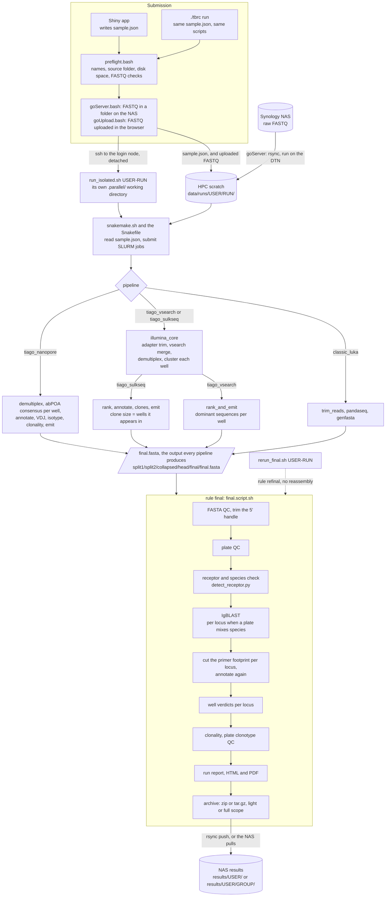

# TBRC Pipeline

TBRC is a Shiny plus Snakemake workflow for plate-based BCR/TCR assembly, QC, IGBlast annotation, optional clonality calling, and packaged result delivery.

The repository has two main components:

- [`frontend/`](frontend): the Shiny submission app
- [`backend/`](backend): the Snakemake workflow and helper scripts

## What This Repo Contains

The pipeline can:

- accept paired FASTQs from direct upload or a remote storage folder
- trim primers and assemble reads
- demultiplex by plate barcode
- build final FASTA outputs and QC summaries
- optionally run IGBlast
- optionally run clonality
- package outputs as `zip` or `tar.gz`
- optionally push results to a storage server

Typical packaged outputs include:

- `<sample>.final.fasta`
- `<sample>.imgt.ready.fasta`
- `qc/`
- `igblast/`
- `clonality/`

## How a Run Flows

A submission from the app or from `./tbrc` goes through the same launch scripts.
The raw FASTQs move to the cluster, and a detached driver runs the chosen assembly
pipeline under SLURM. Every pipeline ends in the same assembled FASTA, so
everything after assembly is shared.



IgBLAST, the primer-footprint cut and clonality run only when the run asks for
annotation. The handle trim is skipped where assembly already removed the handle
(luka_light on classic_luka and tiago_sulkseq, and every tiago_nanopore run).

## Repository Layout

- [`frontend/ui.R`](frontend/ui.R): Shiny UI
- [`frontend/server.R`](frontend/server.R): submission logic and app-side orchestration
- [`frontend/global.R`](frontend/global.R): shared helpers and config readers
- [`frontend/server_config.json`](frontend/server_config.json): deployment-specific configuration
- [`frontend/scripts/`](frontend/scripts): app-side launcher scripts
- [`frontend/www/`](frontend/www): Shiny static assets
- [`environment.yml`](environment.yml): saved `snakemake` conda environment
- [`backend/workflow/Snakefile`](backend/workflow/Snakefile): Snakemake entry point
- [`backend/workflow/rules/`](backend/workflow/rules): workflow rules
- [`backend/workflow/scripts/`](backend/workflow/scripts): backend helper scripts
- [`backend/igblast/`](backend/igblast): IGBlast setup helpers and reference structure

## Install Anywhere

This is the shortest path to get TBRC running on a new machine, cluster, or Shiny host.

### 1. Clone the repository

```bash
git clone <repo-url> TBRC
cd TBRC
```

### 2. Create the saved Snakemake conda environment

The repository root [`environment.yml`](environment.yml) is the saved backend environment snapshot.

```bash
conda env create -f environment.yml
conda activate snakemake
Rscript install_r_pins.R   # CRAN versions that differ from the conda builds (ggplate 0.2.0 etc.)
```

This environment already includes most core backend dependencies such as:

- `snakemake`
- `cutadapt`
- `pandaseq`
- `fastx_toolkit`
- `igblast`
- `R`
- `ggplot2`
- `ggplate`

Useful sanity checks:

```bash
which snakemake
which cutadapt
which pandaseq
which fastx_trimmer
which fastx_collapser
which igblastn
which Rscript
```

### 3. Install extra R packages not guaranteed by the saved environment

If the environment does not already contain everything needed on the target machine, install:

```bash
conda activate snakemake
Rscript -e "install.packages(c('shiny','shinythemes','DT','jsonlite','shinyalert','shinyWidgets'), repos='https://cloud.r-project.org')"
```

For clonality:

```bash
Rscript -e "install.packages('remotes', repos='https://cloud.r-project.org')"
Rscript -e "remotes::install_github('victoraLab/clonality')"
```

or:

```bash
R CMD INSTALL /path/to/clonality_0.10.tar.gz
```

### 4. Decide your deployment pattern

TBRC can be run in three common ways:

1. Local development:
Shiny and Snakemake on the same machine.

2. Split deployment:
Shiny on one host, Snakemake on an HPC or backend server.

3. HPC-first:
Only the backend is deployed and tested before connecting the UI.

## Required Configuration

The main deployment configuration file is:

- [`frontend/server_config.json`](frontend/server_config.json)

You should replace the machine-specific values with your own.

### Required `cluster` fields

These drive how the frontend launches the backend.

```json
{
  "cluster": {
    "dtn_host": "<dtn-host-or-empty>",
    "ssh_host": "<login-host-or-local-host>",
    "pipeline_root": "/absolute/path/to/TBRC",
    "snakemake_env": "snakemake",
    "path_prefix": "/path/to/conda/condabin:/path/to/custom/bin:/usr/local/bin:/usr/bin",
    "igblast_bin": "igblastn",
    "igblast_data": "/absolute/path/to/ncbi-igblast/internal_data",
    "igblast_auxiliary_data": "/absolute/path/to/ncbi-igblast/optional_file",
    "notification_admin_email": "admin@example.org"
  }
}
```

Field meanings:

- `dtn_host`: host used to pull raw data from a storage server onto the backend
- `ssh_host`: host where `snakemake.sh` is launched
- `pipeline_root`: absolute path to the deployed TBRC repository root on the backend host
- `snakemake_env`: conda environment name used for workflow execution
- `path_prefix`: `PATH` exported before `conda activate`, useful on HPC systems
- `igblast_bin`: usually `igblastn`
- `igblast_data`: path to the NCBI `internal_data/` directory
- `igblast_auxiliary_data`: path to the NCBI `optional_file/` directory or a specific `*.aux` file
- `notification_admin_email`: optional admin notification recipient from Shiny

### Required `storage_server` fields

Each storage target needs:

```json
{
  "storage_server": {
    "example_storage": {
      "rawdata_path": "user@host:/absolute/rawdata/path/",
      "results_path": "user@host:/absolute/results/path/",
      "ssh_port": 22,
      "web_port": 0,
      "transfer_mode": "push"
    }
  }
}
```

Field meanings:

- `rawdata_path`: remote `host:path` where input runs live
- `results_path`: remote `host:path` where final packaged runs should land
- `ssh_port`: SSH port for rsync/ssh
- `web_port`: optional metadata only; not required by the backend
- `transfer_mode`:
  - `push`: backend pushes results out at the end
  - `pull`: backend keeps results local and another system should fetch them later

## Local Development Setup

### Run the backend locally

The backend expects:

- `DATA_TABLE`: path to the run metadata file, now typically `sample.json`
- `INPUTPATH`: path to the FASTQ directory

Example:

```bash
conda activate snakemake
cd /path/to/TBRC/backend
export DATA_TABLE=/absolute/path/to/sample.json
export INPUTPATH=/absolute/path/to/input_fastqs
snakemake --cores 4
```

### Run the frontend locally

```bash
cd /path/to/TBRC/frontend
Rscript -e "shiny::runApp('.', host='127.0.0.1', port=8080)"
```

Local development notes:

- `frontend/scripts/goServer.bash` and `goUpload.bash` resolve paths relative to the repo
- upload mode works with paired `.fastq` or `.fastq.gz`
- server mode writes `sample.json` and launches the backend through the configured hosts

## Running From the Terminal (No Browser)

`./tbrc` at the repository root does what the Shiny app does, from a shell. It reads the
same `frontend/server_config.json`, writes the same `sample.json`, and launches the backend
through the same scripts, so the workflow cannot tell the two apart. Python 3.8 or newer,
standard library only; `ssh`, `rsync` and `jq` for anything that touches another machine.

```bash
./tbrc check                 # configuration, HPC login and DTN, conda env, tools, panels, storage servers
./tbrc check --all           # the same, plus what a --local run needs on this machine
./tbrc test                  # sample.json columns + a workflow dry run for two pipelines (no data)
./tbrc run ...               # submit a run
```

### Check the connections first

```
$ ./tbrc check
== configuration (frontend/server_config.json)
[ OK ] cluster.ssh_host: login.hpc.example.org
...
== HPC (user@login.hpc.example.org)
[ OK ] data-transfer node reachable: user@dtn.hpc.example.org
[ OK ] login node reachable: user@login.hpc.example.org
[ OK ] pipeline root: /path/to/scratch/pipelines/TBRC
[ OK ] snakemake.sh and run_isolated.sh present and executable
[ OK ] conda env 'snakemake'
[ OK ] snakemake: 7.32.4
[ OK ] pipeline tools: all present
[ OK ] IgBLAST mouse ig_all panel built
[ OK ] runs active on the cluster: 0
[ OK ] free space under pipeline root: 573 GB
== storage servers
[ OK ] storage1 reachable: direct
[ OK ] storage1 rawdata_path: /path/to/pipelines/tbrc/rawdata/
...
All checks passed.
```

Every `[FAIL]` comes with a `->` line saying what to do. The tool uses SSH in batch mode, so
a host that would prompt for a password counts as unreachable; the fix is a key in
`~/.ssh/config`, not a retry. If your local user name differs from your cluster user, the
tool takes the user from `cluster.dtn_host` (`user@host`), or from `TBRC_SSH_USER` if set.

### Submit a run

Raw data already on a storage server (the usual case):

```bash
./tbrc run --user jdoe --server storage1 --folder RUN15 --primer-set B2
```

`--folder` is one folder name directly under that server's `rawdata_path`, and the run takes
its name from it. The raw data is pulled onto the cluster through the DTN, the run is
dispatched on the login node, and the terminal follows the backend log until the archive is
delivered. Expect tens of minutes; run it under `nohup` or `tmux` if you may disconnect.

FASTQ files on this machine:

```bash
./tbrc run --user jdoe --run-name RUN15 --fastq-dir /path/to/pair --primer-set B2
```

The pair is copied to the cluster and dispatched the same way. Results stay on the cluster
under `results/<user>/<run>/` unless you add `--push`.

The defaults are the form's defaults: `tiago_vsearch`, standard preprocessing, three
contigs per well, IgBLAST on with the `ig_all` panel for mouse, receptor and species check
on, a light zip archive. `./tbrc run --help` lists every option, grouped the way the form
groups them: library, annotation, output, MIBS, where to run.

`--dry-run` prints the `sample.json` and the commands and touches nothing remote:

```bash
./tbrc run --user jdoe --server storage1 --folder RUN15 --primer-set B2 --dry-run
```

### Run locally instead of on the cluster

```bash
./tbrc run --user jdoe --run-name RUN15 --fastq-dir /path/to/pair --primer-set B2 --local --cores 8
```

`--local` runs the workflow on this machine, natively when `snakemake` is on `PATH`
(the `environment.yml` conda env), otherwise inside a `tbrc-backend` Docker image if one is
built (a Dockerfile for that image is not included in this repository yet). Inputs go to `backend/data/runs/<user>/<run>/`, results to
`backend/results/<user>/<run>/`, and the archive is not pushed anywhere unless `--push`.
`--local --server NAME --folder F` also works when this machine can reach the storage server
itself. `./tbrc check --local` says which of these paths is available.

Annotation on a local run needs the IgBLAST reference data inside the checkout, which git
does not carry: `backend/igblast/internal_data/` and the built panels under
`backend/igblast/work/`. `./tbrc check --local` warns when they are missing. With the
Docker image, one command builds both:

```bash
docker run --rm -v "$PWD/backend:/work" -w /work/igblast tbrc-backend:arm64 bash -c \
  'cp -r /opt/conda/share/igblast/internal_data . && ./setup_igblast_databases.sh mouse ig_all && ./setup_igblast_databases.sh human ig_all'
```

### Verify that it works

```bash
./tbrc test                                    # seconds; no data needed
./tbrc test --full --local --fastq-dir /path/to/pair --primer-set B2   # a real run, then checks the outputs
```

`test` first checks that the `sample.json` this tool writes carries every column the
Snakefile reads (it parses the workflow source, so a new column cannot go unnoticed), then
plans a run with `snakemake -n` for `tiago_vsearch` and `classic_luka` on a tiny synthetic
pair, locally or on the cluster. With `--full` it submits the dataset you give it as user
`tbrc_test` and confirms the IMGT-ready FASTA, the IgBLAST table, the report and the
archive exist.

### Errors

The tool refuses before it reaches a remote machine whenever it can: a user or run name
with a character that is not safe in a path, a folder given as a path, a barcode set with
no known trim sequence, both or neither input given, clonality without annotation. Once a
run is dispatched, failures are translated the way the app translates them (folder not
found on the server, not enough space on the cluster, another run active, a failed rule
and which log to read), and the full backend output is kept in the run folder's
`backend.log`. Exit status is 2 for a usage or environment problem, 1 for a failed check
or test, 0 on success.

### Rerun the final stage of a finished run

After an IgBLAST database or panel fix, or to re-make a report, there is no need to assemble
again. On the cluster, from the pipeline root:

```bash
./rerun_final.sh <user>-<run>          # e.g. jdoe-RUN15_all; `ls .parallel/` lists them
./rerun_final.sh <user>-<run> --push   # also push the new archive, replacing the old one on the NAS
```

It reruns the receptor check, annotation, clonality, report and archive from
`<sample>.final.fasta`, after copying the previous archive, report, tables and QC into
`previous-<timestamp>/` in the run's result folder.

## HPC / Backend Installation

Use this when deploying the Snakemake side to a cluster or backend server.

### 1. Copy the repository or backend

```bash
rsync -aP backend/ <backend-user>@<backend-host>:/path/to/TBRC/backend/
rsync -aP environment.yml <backend-user>@<backend-host>:/path/to/TBRC/
```

If you want the IGBlast helpers, docs, and shared root files intact, it is often simpler to copy the whole repo.

### 2. Create the backend environment

```bash
cd /path/to/TBRC
conda env create -f environment.yml
conda activate snakemake
```

### 3. Confirm core tools

```bash
which snakemake
which cutadapt
which pandaseq
which fastx_trimmer
which fastx_collapser
which igblastn
which Rscript
```

### 4. Install clonality if needed

```bash
conda activate snakemake
Rscript -e "install.packages('remotes', repos='https://cloud.r-project.org')"
Rscript -e "remotes::install_github('victoraLab/clonality')"
```

### 5. Set up IGBlast

You need the NCBI IgBlast bundle in addition to the `igblastn` binary:

- `internal_data/`
- `optional_file/`

Then build the panel databases:

```bash
cd /path/to/TBRC/backend/igblast
./setup_igblast_databases.sh mouse ig_all
./setup_igblast_databases.sh human ig_all
./setup_igblast_databases.sh mouse tcr_all
./setup_igblast_databases.sh human tcr_all
```

Validate:

```bash
./check_igblast_setup.sh mouse ig_all
./check_igblast_setup.sh human ig_all
```

Optional smoke test:

```bash
./smoke_test_igblast.sh /path/to/sample.imgt.ready.fasta mouse ig_all
```

See also:

- [`backend/igblast_setup.md`](backend/igblast_setup.md)

## Shiny Server Installation

Use this when deploying the web app to a VM or application host.

### 1. Copy the frontend

```bash
rsync -aP frontend/ <shiny-user>@<shiny-host>:/path/to/shiny/app/
```

### 2. Install required R packages on the Shiny host

```r
install.packages(
  c("shiny", "shinythemes", "DT", "jsonlite", "shinyalert", "shinyWidgets"),
  repos = "https://cloud.r-project.org"
)
```

### 3. Edit deployed `server_config.json`

Update all cluster and storage variables on the deployed copy of:

- [`frontend/server_config.json`](frontend/server_config.json)

### 4. Make sure the app can run bash helpers

The app uses:

- [`frontend/scripts/goUpload.bash`](frontend/scripts/goUpload.bash)
- [`frontend/scripts/goServer.bash`](frontend/scripts/goServer.bash)
- [`frontend/scripts/updatebarcodes.bash`](frontend/scripts/updatebarcodes.bash)

So the Shiny host needs:

- `bash`
- `rsync`
- `ssh`
- `jq`

### 5. Verify static assets

The header image and any future static assets should live in:

- [`frontend/www/`](frontend/www)

For example, the current header image is:

- [`frontend/www/bcr.png`](frontend/www/bcr.png)

## Runtime Variables Used by the Backend

These are usually set automatically by the frontend launcher scripts:

- `DATA_TABLE`: path to `sample.json`
- `INPUTPATH`: path to the FASTQ input folder
- `PATH`: prefixed with `cluster.path_prefix`

For manual debugging, you can set them yourself:

```bash
export DATA_TABLE=/path/to/sample.json
export INPUTPATH=/path/to/input_folder
```

## Minimal Bring-Up Checklist

Use this checklist on a new machine or cluster.

### Backend checklist

- repo copied to backend host
- `conda env create -f environment.yml` completed
- `snakemake`, `cutadapt`, `pandaseq`, `fastx_trimmer`, `igblastn`, and `Rscript` available
- NCBI `internal_data/` downloaded
- NCBI `optional_file/` downloaded
- IGBlast panel DBs built under `backend/igblast/work`
- clonality installed if needed

### Frontend checklist

- frontend copied to Shiny host
- required R packages installed
- `server_config.json` updated with correct hosts and paths
- `bash`, `ssh`, `rsync`, and `jq` available
- Shiny can write under `frontend/runs/`
- `frontend/www/bcr.png` present if using the current header

### Storage checklist

- storage server accepts SSH/rsync from the expected host
- `rawdata_path` and `results_path` are valid
- `transfer_mode` matches the intended behavior

## First Validation Run

1. Start the Shiny app.
2. Submit one small test run.
3. Confirm that the run folder contains:
   - `sample.json`
4. Confirm the backend produces:
   - `<sample>.final.fasta`
   - `<sample>.imgt.ready.fasta`
   - `qc/`
5. If IGBlast is enabled, confirm:
   - `igblast/<sample>.igblast.tsv`
6. If clonality is enabled, confirm:
   - `clonality/<sample>.clonality.tsv`
7. Confirm the final archive is produced and, if using push mode, transferred to the storage server.

## What Ends Up in the Results Archive

Two independent switches, often confused:

- **Keep intermediate files** (`keep_raw` in `sample.json`) only decides whether the bulky
  intermediates survive **on disk** in the run directory on the compute host: the
  demultiplexed per-well FASTA tree `split1/`, `<sample>.fasta`, the trimmed FASTQ and the
  two barcode stats files. None of those has ever been put into the archive.
- **Results archive contents** (`archive_scope` in `sample.json`, `-A` on
  `final.script.sh`) decides what goes **into** the delivered archive.

| | `light` (default) | `full` |
|---|---|---|
| `<sample>.imgt.ready.fasta` | yes | yes |
| `qc/**/*.tsv`, `qc/**/*.pdf` | yes | yes |
| `qc/*.contig_lengths.png` | yes | yes |
| `igblast/`, `clonality/` | yes | yes |
| `ARCHIVE_CONTENTS.txt` | yes | yes |
| `<sample>.final.fasta` (untrimmed; already trimmed on `luka_light`) | yes | yes |
| `qc/plates/*.plate_*.png`, `qc/plates/*.panel.png` | no | yes |

Every per-plate PNG is one page of a sibling multi-page PDF that `light` keeps, so the
information is not lost - and the prune only ever removes a PNG whose PDF is actually in
the package. On a real 16-plate run (`RUN13`) that is **12,567,922 B -> 602,037 B**, a 95%
reduction, because 12.2 MB of the old archive was per-plate PNG raster.

A `sample.json` written before `archive_scope` existed has no such field. In that case the
backend derives the scope from the only related intent the file does express: `keep_raw`
true gives `full`, anything else gives `light`.

## Troubleshooting

- Metric cards show missing helper functions:
  frontend files were deployed out of sync; redeploy at least `global.R` and `server.R`.

- Header image does not appear:
  make sure the file lives under `frontend/www/`, not outside the app directory.

- IGBlast says built databases are missing:
  rebuild them with `backend/igblast/setup_igblast_databases.sh` in the live backend path.

- IGBlast says `internal_data` is missing:
  fix `cluster.igblast_data` or place `internal_data/` where the backend expects it.

- Server submission says folder not found:
  check `storage_server.<name>.rawdata_path`, `ssh_port`, and the requested folder name.

- Synology or NAS pull includes `@eaDir` files:
  current launcher scripts already exclude them, but older deployed copies may still need updating.

## Related Docs

- [`backend/README.md`](backend/README.md)
- [`frontend/readme.md`](frontend/readme.md)
- [`backend/igblast_setup.md`](backend/igblast_setup.md)
