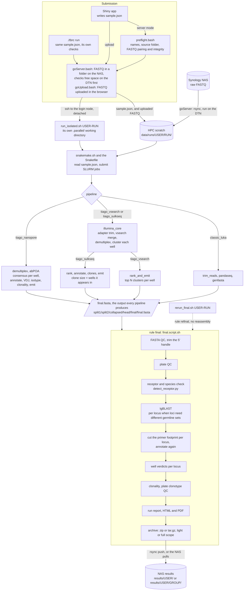
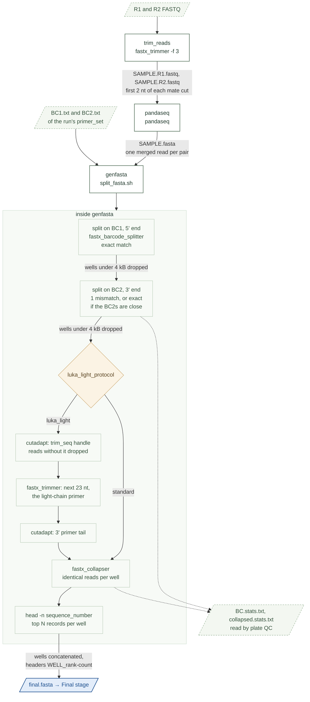
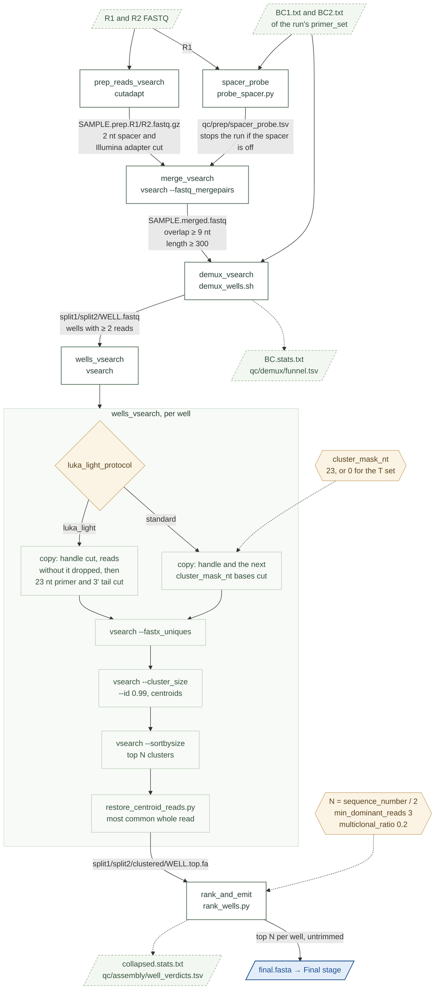
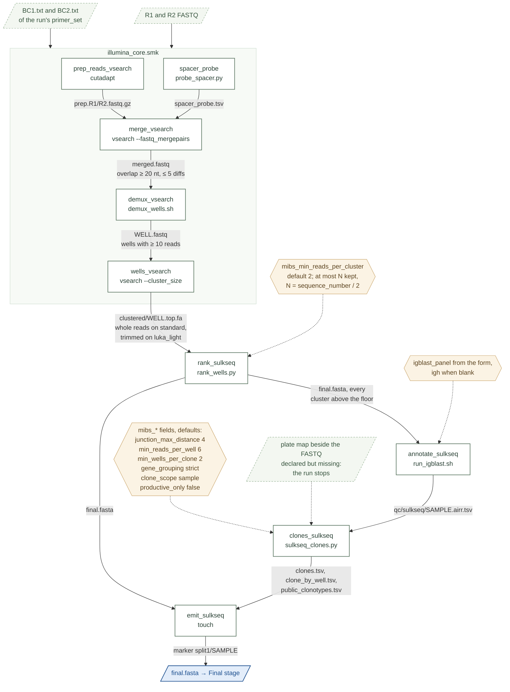
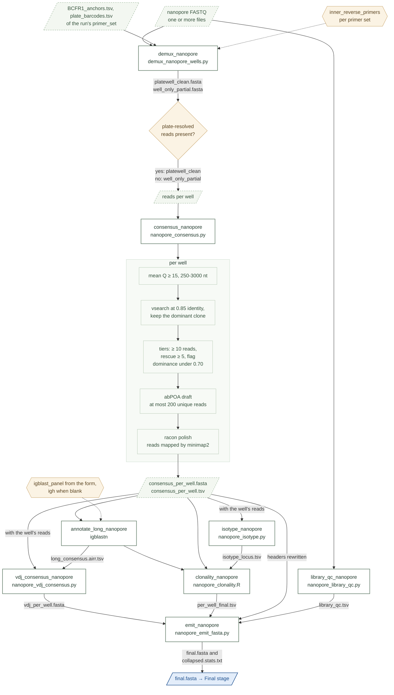

# Pipeline diagrams

These diagrams are drawn from the code: the Snakefile's `PIPELINE_RULES`, the rule files in `backend/workflow/rules/` and the scripts they call. White boxes are Snakemake rules, pale boxes are steps inside one rule, dashed shapes are files, and amber diamonds and hexagons are the settings that change the path. Every assembly pipeline ends in the same file, `split1/split2/collapsed/head/final/final.fasta`, and the final stage takes it from there.

## How a run flows

A submission from the app or from `./tbrc` runs the same launch scripts, and every pipeline ends in the same assembled FASTA, so everything after assembly is shared.

## classic_luka

The original method: fastx_trimmer and pandaseq make one merged read per pair, and `split_fasta.sh` demultiplexes, collapses identical reads and keeps the top sequences of each well. On luka_light runs the handle, the light-chain primer and the 3' tail are cut before collapsing, so the final stage does not trim them again.

## tiago_vsearch

Adapter trimming, vsearch merging, error-tolerant demultiplexing and 99% clustering in each well, after which the clusters are ranked and the top N of each well delivered as whole, untrimmed reads. Clustering sees a copy of each read with the primer footprint hidden, so a degenerate primer cannot split one clone into several clusters.

## tiago_sulkseq

For MIBS libraries, where a well holds about a hundred cells and a clone's size is the number of wells it appears in. It shares the front half with tiago_vsearch, keeps every cluster above a read floor, annotates them itself and groups clones across wells with the `mibs_*` settings from the form.

## tiago_nanopore

Single-end long reads span the whole amplicon, so there is nothing to merge: reads are assigned to wells by their plate and well barcodes, and each well's dominant clone becomes one abPOA consensus polished with racon. Its tools come from a separate conda environment put first on the PATH.

## Final stage

`final.script.sh` takes the assembled FASTA from any pipeline through trimming, QC, annotation, clonality, the run report and delivery, and the diamonds are the settings that change its path. `rerun_final.sh` reruns the same stage on a finished run from its kept `SAMPLE.final.fasta`, without assembling again.

```mermaid
flowchart TD
    classDef rule fill:#ffffff,stroke:#5f7965,stroke-width:1.5px,color:#294034
    classDef step fill:#f7faf6,stroke:#b8cbb6,color:#35523c
    classDef file fill:#f3f7f1,stroke:#8fad8d,stroke-dasharray:4 3,color:#35523c
    classDef param fill:#fbf3e4,stroke:#c9a46a,color:#5c4420
    classDef contract fill:#e3edfa,stroke:#1c4f8f,stroke-width:1.5px,color:#1c4f8f

    contract[/"final.fasta → Final stage"/]:::contract
    fin["rule final<br/>final.script.sh"]:::rule
    rerun["rerun_final.sh USER-RUN<br/>previous outputs copied<br/>to previous-DATE/"]:::rule
    refinal["rule refinal<br/>final.script.sh"]:::rule
    ff[/"SAMPLE.final.fasta, always archived<br/>untrimmed unless luka_light trimmed it"/]:::file

    contract --> fin
    fin -->|"final.fasta moved here"| ff
    rerun --> refinal
    refinal -.->|"reused, no reassembly"| ff

    ff --> ht{"handle trim?"}:::param
    defs{{"PRETRIMMED: luka_light,<br/>not tiago_vsearch<br/>HANDLE_REMOVED: tiago_nanopore"}}:::param
    defs -.-> ht
    ht -->|"trim_primers on,<br/>handle still on"| cut["cutadapt -g trim_seq<br/>reads without it dropped<br/>luka_light: 3' tail cut too"]:::step
    ht -->|"trim_primers off, or<br/>PRETRIMMED, HANDLE_REMOVED"| cp["copied unchanged"]:::step
    cut -->|"none kept: run fails"| imgt
    cp --> imgt[/"SAMPLE.imgt.ready.fasta"/]:::file

    imgt --> fqc["FASTA QC<br/>fasta_qc.R"]:::step
    fqc --> pqc["plate QC: plate_stats.R, plate_depth_qc.R<br/>skipped when their stats files are gone"]:::step
    pqc --> ig{"run_igblast"}:::param

    ig -->|"true"| rc{"receptor_check"}:::param
    rc -->|"auto"| dra["detect_receptor.py<br/>corrects panel and species"]:::step
    rc -->|"warn, or auto with<br/>pinned V/J databases"| drw["detect_receptor.py<br/>reports only"]:::step
    rc -->|"off"| rig
    dra --> plan{"per-locus plan?"}:::param
    plan -->|"yes: loci need<br/>different germline sets"| apl["annotate_per_locus.py<br/>each locus on its own set"]:::step
    plan -->|"no"| rig["run_igblast.sh<br/>igblastn"]:::step
    drw --> rig
    apl --> ex{"exit status"}:::param
    rig --> ex
    ex -->|"64: not set up here"| skip["IgBLAST skipped,<br/>run continues"]:::step
    ex -->|"other non-zero"| fail["run fails"]:::step
    ex -->|"0"| vid["median V identity<br/>flagged under 85%"]:::step

    vid --> fp{"footprint cut?"}:::param
    fp -->|"primer_footprint set,<br/>trim_primers on,<br/>not PRETRIMMED"| fpc["trim_primer_footprint.py<br/>IGK=23, by each V call"]:::step
    fpc -->|"records cut"| again["annotate again,<br/>same route"]:::step
    fpc -->|"none cut"| wv
    fp -->|"otherwise"| wv
    again --> wv["per-locus well verdicts<br/>well_verdicts_by_locus.py"]:::step

    wv --> rcl{"run_clonality"}:::param
    skip --> rcl
    ig -->|"false"| rcl
    rcl -->|"true, with a table"| clon["clonality<br/>run_clonality.R"]:::step
    rcl -->|"false"| pcq
    clon --> pcq["plate clonotype QC<br/>plate_clonotype_qc.R"]:::step
    pcq --> rpt["run report, HTML and PDF<br/>run_report.R"]:::step

    rpt --> sc{"archive_scope"}:::param
    sc -->|"light, or unset<br/>with keep_raw false"| al["archive without<br/>per-plate PNGs"]:::step
    sc -->|"full, or unset<br/>with keep_raw true"| af["archive with<br/>per-plate PNGs"]:::step
    al --> zip[/"SAMPLE.zip or SAMPLE.tar.gz"/]:::file
    af --> zip

    zip --> cln["cleanup if keep_raw is false:<br/>split1/, SAMPLE.fasta,<br/>BC and collapsed stats"]:::step
    cln --> tm{"transfer_mode"}:::param
    tm -->|"push"| push["rsync to the storage server,<br/>run_group subfolder if set"]:::step
    tm -->|"pull, or refinal<br/>without --push"| pull["archive stays on the cluster"]:::step
    push --> mail["notification email"]:::step
    pull --> mail
```

